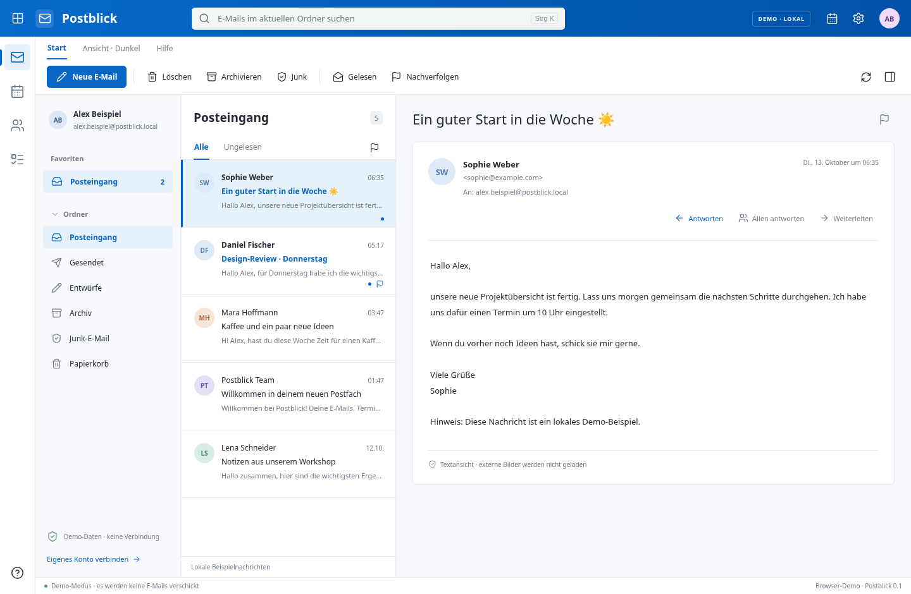

# Postblick

Ein eigenständiger, deutschsprachiger Desktop-Mailclient mit einer an Outlook orientierten Oberfläche. Erste Windows-Version für x64, entwickelt mit Electron, React und TypeScript. Postblick ist kein Microsoft-Produkt.



## Windows installieren

**[Windows-Installer 0.1.1 herunterladen](https://github.com/JonnyTheK1d/Outlook_Clone/releases/download/v0.1.1/Postblick-0.1.1-Windows-x64-Setup.exe)** · [Release und Prüfsumme](https://github.com/JonnyTheK1d/Outlook_Clone/releases/tag/v0.1.1).

Lade die EXE unter **Assets** des Releases herunter. Die vollständige Datei hat ungefähr 113 MB. **„Source code (zip)“ und „Download ZIP“ sind keine Installer.** Repository-Archive können anstelle großer Dateien nur kleine Git-LFS-Verweise enthalten. Eine EXE mit wenigen Bytes oder KB kann Windows nicht ausführen; lösche diesen Download und lade das vollständige Release-Asset.

Als Git-LFS-Kopie liegt die EXE unter [`installers/Postblick-0.1.1-Windows-x64-Setup.exe`](installers/Postblick-0.1.1-Windows-x64-Setup.exe), mit [`installers/SHA256SUMS`](installers/SHA256SUMS). Für einen lokalen Git-Checkout mit der vollständigen Datei benötigst du Git LFS (`git lfs install`, danach `git lfs pull`). Der Release-Download benötigt keinen Git-LFS-Client.

Der Installer liegt nach dem Build unter `release/Postblick-0.1.1-Windows-x64-Setup.exe`. Unterstützt werden Windows 10/11 x64. Starte den Installer, wähle einen Installationsort und öffne Postblick. Die App beginnt mit eindeutig gekennzeichneten lokalen Demo-Daten. Im Demo-Modus wird keine E-Mail verschickt.

Der Installer ist **nicht digital signiert**; Windows kann deshalb eine SmartScreen-Warnung anzeigen. Für eine öffentliche Veröffentlichung sind ein Code-Signing-Zertifikat, ein Sicherheitstest und Tests auf echten Windows-Systemen erforderlich. Zertifikats- oder Sicherheitswarnungen sollten nicht pauschal abgeschaltet werden.

## Funktionen

| Bereich | Implementiert |
| --- | --- |
| Oberfläche | App-Leiste, Ordner, Nachrichtenliste, Lesebereich, Mein Tag, helle/dunkle Darstellung |
| E-Mail | Lesen, Suche im geladenen Ordner, gelesen/ungelesen, Flaggen, Archiv, Junk, Papierkorb, endgültiges Löschen mit Rückfrage |
| Schreiben | Text-E-Mails, An/Cc, Antworten/Allen antworten/Weiterleiten, Entwürfe, Anhänge auswählen und speichern |
| Microsoft | OAuth mit PKCE, Graph-Mail, Kalender und Kontakte |
| IMAP/SMTP | IMAPS 993, SMTPS 465 oder erzwungenes STARTTLS 587; App-Passwort |
| Kalender | Monatsansicht, Termine erstellen/bearbeiten/löschen |
| Kontakte | Adressbuch, Kontakte erstellen/bearbeiten/löschen, Nachricht an Kontakt |
| Aufgaben | Lokale Aufgaben mit Fälligkeitsdatum, Erledigen/Öffnen und Löschen |
| Speicherung | Persistente Demo; verschlüsselter Cache und Zugangsdaten für echte Konten |

Ein aktives Konto wird unterstützt. Bei IMAP sind Kalender und Kontakte lokal; Aufgaben sind für beide Kontotypen lokal. Ordner und Suche umfassen die neuesten **100 Nachrichten je geöffnetem Standardordner**. Microsoft-Kalender lädt maximal 100 Einträge für ±90 Tage, Kontakte maximal 100 Einträge. Synchronisierung erfolgt beim Verbinden, Ordnerwechsel und per Aktualisieren-Schaltfläche; kein Hintergrund-Push. IMAP-Standardordner müssen über SPECIAL-USE markiert sein. SMTP-Annahme ist keine Zustellbestätigung; eine Kopie im Gesendet-Ordner hängt bei IMAP/SMTP vom Anbieter ab. Anhänge werden bei Weiterleitungen nicht automatisch übernommen.

Neue Anhänge: insgesamt 2 MB, maximal 10 Dateien. Downloads: maximal 20 MB. Größere IMAP-Nachrichten werden nicht vollständig eingelesen. Dateianhänge werden nicht automatisch geöffnet. Bearbeitete Entwürfe behalten bestehende Anhänge; neue Dateien werden ergänzt. Das Entfernen bestehender Server-Anhänge ist noch nicht vorgesehen.

Noch nicht umgesetzt: mehrere Konten gleichzeitig, benutzerdefinierte Ordner, serverweite Suche, Regeln, Exchange-Freigaben, Besprechungseinladungen/Serientermine, Microsoft To Do, S/MIME/PGP, Spam-/Malware-Erkennung, Offline-Sendequeue und automatische Updates. Dies ist eine funktionsfähige erste Version, keine vollständige Outlook-Parität.

## Microsoft 365 / Outlook.com einrichten

Die frühe Entwicklungsversion benötigt eine eigene **öffentliche Client-ID**, kein Client-Secret. Eine Client-ID ist kein Passwort und darf in den Einstellungen eingegeben werden.

1. In Microsoft Entra eine App registrieren. Unterstützte Konten: Konten in beliebigen Organisationsverzeichnissen **und persönliche Microsoft-Konten**.
2. Unter Authentifizierung die Plattform **Mobile und Desktopanwendungen** hinzufügen. Redirect-URI: `http://localhost/callback`. Postblick wählt für jede Anmeldung einen freien lokalen Port; Microsoft erlaubt dynamische Ports bei localhost-Redirects öffentlicher Desktop-Clients. Falls erforderlich öffentliche Clientflows aktivieren.
3. Delegierte Microsoft-Graph-Berechtigungen konfigurieren: `User.Read`, `Mail.ReadWrite`, `Mail.Send`, `Calendars.ReadWrite`, `Contacts.ReadWrite`. Zusätzlich werden `openid`, `profile`, `offline_access` bei der Anmeldung angefordert. Je nach Organisation ist die Zustimmung eines Administrators nötig.
4. In Postblick unter **Einstellungen → Konto → Microsoft** die Anwendungs-ID eingeben und anmelden. Der Systembrowser zeigt die Microsoft-Anmeldung und Berechtigungen.

Postblick verarbeitet dein Microsoft-Passwort nicht. Der lokale Callback wird mit zufälligem State und PKCE geschützt und nach drei Minuten geschlossen. Refresh-Token werden verschlüsselt gespeichert. Beim Trennen entfernt Postblick seinen lokalen Cache und die lokalen Zugangsdaten; eine bereits erteilte Microsoft-App-Zustimmung kannst du zusätzlich im Microsoft-Konto widerrufen. Alte Daten können in Betriebssystem-Backups erhalten bleiben.

Für eine spätere öffentliche App wird eine vom Herausgeber verwaltete Microsoft-App-Registrierung benötigt. OAuth-Anmeldung, Versand und Synchronisierung mit echten Konten sind ohne Testkonto noch nicht Ende-zu-Ende verifiziert.

## IMAP/SMTP einrichten

Unter **Einstellungen → Konto → IMAP/SMTP** E-Mail-Adresse, Anbieter-Server und App-Passwort eintragen. IMAP muss TLS auf 993 unterstützen; SMTP wird auf 465 mit TLS oder auf 587 mit verpflichtendem STARTTLS verbunden. Serverzertifikate werden überprüft. Kein Klartext-Fallback, keine deaktivierte Zertifikatsprüfung. IMAP und SMTP werden vor dem Speichern getestet. Anbieter mit ausschließlich OAuth-IMAP-Authentifizierung werden noch nicht unterstützt; Microsoft-Konten verwenden die Microsoft-Anmeldung. Die Einträge verbleiben auf dem eigenen Rechner und werden nicht als Cloud-Geheimnisse gespeichert.

## Entwicklung

Node.js 24.19.0 oder neuer, npm 11+. Windows-Entwicklung:

```sh
npm ci
node node_modules/electron/install.js
npm run dev
```

```sh
npm run typecheck
npm test
npm run build
npm run dist:win
```

`dist:win` erzeugt einen NSIS-Installer für den aktuellen Benutzer mit Installationsortwahl, Verknüpfungen und Deinstallation. Das eigene NSIS-Skript erzeugt den Uninstaller direkt; ein Linux-Cross-Build benötigt kein Wine. Der Uninstaller entfernt nur ausgelieferte Programmdateien und behält persönliche Daten im Benutzerprofil. Cloud-Anleitung: [docs/cloud.md](docs/cloud.md).

Die Browseransicht `npm run dev:web` ist ausschließlich eine lokale Demo und hat keine Fähigkeit, echte Konten zu verbinden. Browser-Daten und Desktop-Daten sind getrennt. Für UI-Tests wird Playwright genutzt; `POSTBLICK_CHROMIUM` kann einen installierten Chromium-Pfad angeben. Ohne diesen Pfad wird `/usr/bin/chromium` verwendet (Cloud-Standard).

## Sicherheit

Details und Grenzen: [SECURITY.md](SECURITY.md). Es gibt bisher kein unabhängiges Sicherheitsaudit und keine Zusicherung eines mit Outlook vergleichbaren Sicherheitsniveaus. Bitte nutze zunächst ein Testkonto.

Prüfergebnisse: [docs/validation.md](docs/validation.md). Der Windows-Build-Workflow liegt unter `.github/workflows/windows.yml`. `.github/workflows/release.yml` prüft bei einem Versionstag den bereitgestellten Installer auf Windows und veröffentlicht danach die vollständige EXE sowie Prüfsummen als Release-Assets.

## Architektur

`src/` enthält ausschließlich die React-Oberfläche. `electron/preload.ts` stellt eng begrenzte IPC-Funktionen bereit. `electron/main.ts` validiert Aufrufe und verwaltet native Dialoge. `electron/providers.ts` spricht Microsoft Graph bzw. IMAP/SMTP. `electron/store.ts` verschlüsselt echte Kontodaten über Electron safeStorage (unter Windows DPAPI). Zugangstoken und Dateipfade werden nie an die Oberfläche zurückgegeben.

macOS ist im jetzigen Release nicht paketiert oder geprüft. Die Architektur erlaubt einen späteren macOS-Build; Signierung, Notarisierung und Plattformtests folgen separat.
